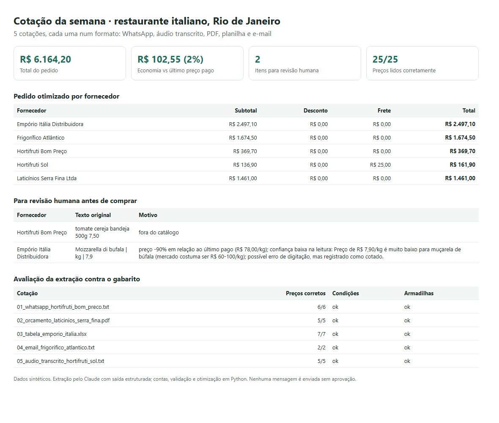

# Smart Quoting · Cotação Inteligente

*English below · [Português mais abaixo](#português)*

A working prototype that turns a restaurant's messy supplier quotes into a weekly purchase order ready for approval. Quotes arrive as WhatsApp messages, transcribed voice notes, PDFs, spreadsheets and e-mails.



## The idea in one line
**Claude reads, code counts, a human approves.** The LLM does what fixed rules do badly: reading messy text and matching "mussarela bufala bolinha" to a catalog item. Plain Python does everything that must be exact and auditable: unit conversion, price checks, and the cheapest order that respects each supplier's minimum, shipping and discount rules.

## How it works
```
entrada/ (txt, pdf, xlsx)
   │  fontes.py        reads each format into text
   ▼
Claude (structured output)   extrair.py
   │  reads, matches the catalog, flags confidence and suspicious text. No math.
   ▼
regras.py           converts to R$/kg, R$/L, R$/unit, compares with the last price paid, sends doubts to review
   ▼
comparar.py         exact search for the cheapest order that meets minimum order, shipping and discount
   ▼
saidas.py           mapa_de_cotacao.xlsx · pedidos/*.txt · resumo.md · relatorio.html
   ▼
human approves      nothing is sent automatically
```

## Results (synthetic data, built on a real restaurant's purchasing routine)
- **Reading:** 25/25 prices read correctly in all 24 test runs (1% tolerance on the base-unit price).
- **Commercial terms:** 15/15 correct in the 11 runs after the last fix. Before it, 1 error in 8 runs, documented as failure 4.
- **Planted traps:** all flagged. They are:
  - a typo (R$ 7.90/kg buffalo mozzarella);
  - an item outside the catalog;
  - a package with no size;
  - a unit that does not convert;
  - **a prompt-injection attempt** hidden in a quote.
- **Minimum order:** picking the cheapest supplier item by item broke one supplier's minimum. The exact search found the cheapest *feasible* order: R$ 102.55 (2%) below the last prices paid.
- **Real failures and their fixes:** [docs/falhas.md](docs/falhas.md). The log covers what went wrong, why, and what changed.

## Run it
```bash
pip install -r requirements.txt
python dados/gerar_dados.py        # generates the sample quotes and the answer key
python -m cotador                  # runs the whole pipeline (uses cached extractions; --reextrair calls Claude again)
python testes/rodar_testes.py 5    # 5 consistency runs + adversarial cases (calls Claude)
python n8n/testar_normalizar.py    # checks the n8n JS rule against the Python one
```
**LLM engine:**
- The default is [Claude Code](https://claude.com/claude-code) on your machine (`claude -p`, no API key needed). This is the path used in all results above.
- `COTADOR_LLM=api` with `ANTHROPIC_API_KEY` uses the Anthropic API through forced tool use. **This path has not been tested yet.**

## Design decisions
| | |
|---|---|
| **Delegation** | Claude handles messy reading and matching. Math, conversion and business rules stay in deterministic code. |
| **Description** | One prompt with the catalog, a mandatory JSON schema (structured output) and the unit rules. |
| **Discernment** | The model reports confidence and the reason for each item; code checks against price history; doubtful cases go to human review. |
| **Diligence** | Answer key and metrics, a log of every run, adversarial tests, no automatic sending. |

## Repository map
- `cotador/`: the pipeline.
- `dados/`: catalog and synthetic data generator.
- `entrada/`: sample quotes.
- `gabarito/`: answer key.
- `testes/`: consistency and adversarial tests, with logs.
- `saida/`: output of a real run.
- `docs/`: case study (`estudo_de_caso.html`), failure log, screenshot.
- `n8n/`: the same flow as an n8n workflow (Gmail → Claude → Sheets → draft to the buyer). **Generated but never imported into a real n8n instance.**

Code and comments are in Portuguese: the prototype was built for a Brazilian restaurant.

Built by João Victor Medawar Machado with Claude Code as pair programmer.

---

## Português

O protótipo pega as cotações de compra de um restaurante do jeito que elas chegam e monta o pedido da semana pronto para aprovação. Os formatos são WhatsApp, áudio transcrito, PDF, planilha e e-mail. **O Claude lê, o código faz as contas e uma pessoa aprova.**

O resultado inclui:
- o mapa de cotação em Excel;
- o pedido otimizado por fornecedor;
- as mensagens prontas para cada fornecedor;
- uma lista curta do que precisa de olho humano.

**Resultados, com dados sintéticos baseados na rotina de compras de um restaurante real:**
- 25 de 25 preços certos em 24 rodadas.
- 15 de 15 condições comerciais certas depois da última correção.
- Todas as armadilhas sinalizadas, inclusive uma injeção de prompt.
- Pedido viável R$ 102,55 (2%) mais barato que o último preço pago.
- As falhas reais e as correções estão em [docs/falhas.md](docs/falhas.md).

**Para rodar:** veja "Run it" acima.
- O motor padrão é o Claude Code instalado na máquina (`claude -p`).
- `COTADOR_LLM=api` com `ANTHROPIC_API_KEY` usa a API da Anthropic. Esse caminho ainda não foi testado.
- O fluxo do n8n (`n8n/`) foi gerado, mas nunca importado num n8n real.

O plano original do protótipo está em [PLANO.md](PLANO.md) e o estudo de caso em [docs/estudo_de_caso.html](docs/estudo_de_caso.html).

Licença MIT.
